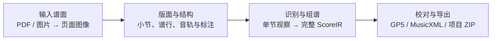
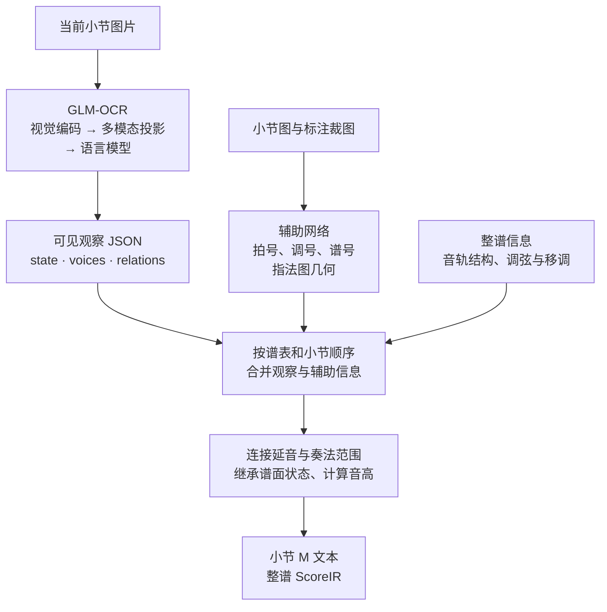

# GuitarOCR

把乐谱 PDF 或图片变成可编辑的乐谱，对照原图校对，再导出 **Guitar Pro（GP5）、MusicXML 或项目 ZIP**。支持 TAB、五线谱、五线谱＋TAB，以及吉他、贝斯、鼓、钢琴等乐器的多轨编辑。

[下载 0.1](https://github.com/Flurry-L/guitarOCR/releases/tag/v0.1.0) · [识别流程](#识别流程) · [项目架构](#项目架构) · [源码运行](#源码运行) · [数据与训练](#数据与训练)


## 开始使用

| 平台 | 安装与运行 |
| --- | --- |
| Windows x64 | 下载 `.exe` 安装包，需要 WebView2；支持 NVIDIA GPU 和 CPU |
| Apple 芯片 Mac | 下载 `.dmg`，要求 macOS 13.4+，使用 Apple GPU |
| Linux、Intel Mac | 从源码运行或构建 |
| 浏览器 | 连接自托管服务，识别在服务器完成 |

首次识别会下载约 3.4 GB 模型。也可以直接打开内置的 Harbor Light 示例，体验编辑和导出。

1. **导入** PDF 或图片，开始识别。
2. **检查区域**，调整或补上小节框，确认音轨、乐器和调弦。
3. **对照校对**，在工作台修改音符、节奏、奏法、和弦名与指法图。
4. **导出** GP5 / MusicXML，或保存包含原图与编辑进度的项目 ZIP。

<details>
<summary>macOS 首次打开</summary>

当前安装包未签名、公证。如果提示无法打开，从本项目发布页下载并将应用拖到「应用程序」后执行：

```bash
xattr -dr com.apple.quarantine /Applications/GuitarOCR.app
```

</details>

## 识别流程

核心做法是 **先读当前图中画出的内容，再根据多小节关系组成完整乐谱**。神经网络负责读图，音乐核心负责状态继承、跨节连接、音高计算和导出。



### 1. 找到小节，建立整谱结构

PDF 先转为页面图像。基于 **PP-DocLayoutV3** 微调的检测器找出小节、谱头、谱号、速度和标注区域，质量网络对候选框评分，程序整理顺序与重复区域。

接着，信息模型结合谱行图像和结构辅助网络，确定哪些谱表属于同一乐器、哪些小节在同一时间位置、跨行后如何接续，并读取标题、乐器名、调弦、变调夹等信息。小节框同时保留本节上方的和弦名、指法图和奏法，让后续识别能看到完整的局部内容。

### 2. 网络读取一张小节图

小节识别基于 **GLM-OCR** 微调。图片按原比例缩放、补白，经过视觉编码器与多模态投影，再由语言模型生成结构化观察。信息读取使用同架构的独立权重，按阶段切换。



| 字段 | 记录什么 |
| --- | --- |
| `state` | 本图印出的拍号、调号、谱号及其变化 |
| `voices` | 各声部的音符、休止、起点、时值和局部奏法；TAB 记录弦与品位，五线谱记录谱位和升降号 |
| `relations` | 延音、击勾弦、滑音、PM、let ring、八度线等连接或范围，以及延伸到图外的端点 |

例如，某节开头只有延音弧、没有品位数字，模型记录「从左侧进入的延音」和本节可见的节奏；组谱时再从上一节找到对应音符。PM 标签只出现在前一节时，本节记录续线的位置和端点，组谱时接回它所属的范围。这样，单节的视觉结果和跨节的音乐关系分别有清楚的来源。

辅助模型负责几类局部任务：谱线与弦数、拍号调号、谱号位置、谱行与音轨关系、文字类别、指法图几何。它们以 ONNX 部署。和弦名关联到小节中的拍点，指法图作为和弦注释保存；谱首的指法库也单独保留。

### 3. 跨小节组谱

[`scorelib/src/observation.rs`](scorelib/src/observation.rs) 沿同一谱表的时间顺序合并观察，继承拍号、调号与谱号，连接相邻小节的延音和奏法范围。连接依据包括端点、声部、线条位置和关系类型。

之后计算音高：TAB 由弦、品位和调弦得到音高；五线谱由谱位、谱号、调号和临时升降号得到音高，再应用乐器移调与八度范围。仍缺少的信息保留在项目中，供用户对照原图补全。

组谱结果进入统一的 **ScoreIR**，编辑器和 GP5 / MusicXML 导出器都围绕它工作。修改某节的连接或谱面状态后，可以重新组谱，更新受影响的相邻小节。项目 ZIP 还保留原图、局部观察与编辑进度。

## 项目架构

桌面应用和网页服务使用同一套工作台、Rust 后端与音乐核心。桌面由 Tauri 启动本机后端；服务部署增加账号和项目空间。Python 用于数据生产、训练和评估，应用识别由原生组件完成。

| 模块 | 职责 | 建议阅读入口 |
| --- | --- | --- |
| `ui/` | 原图、区域与乐谱编辑，项目管理 | [`workbench/app.js`](ui/workbench/app.js) |
| `desktop/` | Tauri 窗口、本机后端与系统交互 | [`main.rs`](desktop/src-tauri/src/main.rs) |
| `backend/` | 导入、识别管线、项目状态和编辑接口 | [`pipeline.rs`](backend/src/pipeline.rs) → [`recognition.rs`](backend/src/recognition.rs) |
| `engine/` | 设备选择、llama.cpp 模型进程与推理调度 | [`runtime.rs`](engine/src/runtime.rs) |
| `scorelib/` | 观察组装、音乐表示、GP5 / MusicXML 导出 | [`observation.rs`](scorelib/src/observation.rs) → [`score.rs`](scorelib/src/score.rs) → [`music_exports.rs`](scorelib/src/music_exports.rs) |
| `research/` | 数据生成、网络定义、训练、评测与模型导出 | [`data/observations.py`](research/data/observations.py)、[`models/`](research/models)、[`training/`](research/training) |
| `gpbridge/` | 调用 Guitar Pro 导出 PDF、源谱结构与绘制坐标，用于造数据 | [`guitarpro_pdf.py`](gpbridge/guitarpro_pdf.py) |
| `weights/` | 当前模型、训练权重与部署清单 | [`distribution.json`](weights/distribution.json) |
| `scripts/`、`deploy/` | 原生组件收集、安装包构建与服务配置 | [`desktop.yml`](.github/workflows/desktop.yml)、[`guitarocr.service`](deploy/guitarocr.service) |

第一次读代码，建议沿 **`pipeline.rs` → `recognition.rs` → `observation.rs` → `score.rs`** 走一遍，再按兴趣看编辑器或训练。研究代码通过 PyO3 调用同一套 Rust 组谱与导出核心。

数据有三个层次：**可见观察**保留网络在当前图上读到的内容。**M 文本**表示已经组装的小节，适合查看音符和节奏。**ScoreIR** 保存完整乐谱的音轨、谱表、统一时间轴及小节内容。

```text
M time=4/4 tempo=120 | V0{@0:q:s1f0 @960:q:s2f1 @1920:h:r}
```

这个小节为 4/4 拍：第 1 拍弹第 1 弦空弦，第 2 拍弹第 2 弦第 1 品，随后休止两拍。`V0` 是第一个声部，四分音符为 960 ticks；`q`、`h` 是四分与二分音符，`s1f0` 表示弦品，`r` 表示休止。完整语法与结构见 [`score.rs`](scorelib/src/score.rs)。

## 源码运行

需要 Rust 1.90+。先启动工作台，打开内置示例即可体验编辑和导出：

```bash
GIT_LFS_SKIP_SMUDGE=1 git clone https://github.com/Flurry-L/guitarOCR.git
cd guitarOCR
cargo run --locked -p guitarocr-backend -- --assets ui/workbench --port 7860
```

访问 `http://127.0.0.1:7860`。启用识别时，按下方构建说明准备 ONNX Runtime、PDFium 和 llama.cpp，再通过 `--resources` 指定原生组件目录，`--models` 指定模型缓存目录：

```bash
cargo run --locked -p guitarocr-backend -- \
  --assets ui/workbench --resources desktop/src-tauri/resources/native \
  --models tools/model-cache --port 7860
```

### 服务部署

将准备好的 `desktop/src-tauri/resources/` 放到服务目录。创建管理员后，以服务模式启动，前方配置 HTTPS 反向代理：

```bash
read -rsp '管理员密码: ' GUITAROCR_ADMIN_PASSWORD
export GUITAROCR_ADMIN_PASSWORD
./native/guitarocr-backend --projects /var/lib/guitarocr/projects --create-admin admin
unset GUITAROCR_ADMIN_PASSWORD
./native/guitarocr-backend --server --bind 127.0.0.1 --port 8080 \
  --public-url https://ocr.example.com --assets ui/workbench --resources native \
  --projects /var/lib/guitarocr/projects --models /var/lib/guitarocr/models --slots 1
```

服务配置见 [`deploy/guitarocr.service`](deploy/guitarocr.service) 和 [`deploy/Caddyfile`](deploy/Caddyfile)。项目、账号与导出保存在 `--projects` 指定的目录，`--slots` 控制推理并发。

## 数据与训练

训练数据来自 **GP 源谱与程序合成谱**，通过 Guitar Pro、alphaTab、Verovio 获得不同排版风格。`gpbridge` 导出 Guitar Pro 的 PDF、布局坐标和源谱结构；合成谱补充延音、跨节奏法、八度线、和弦图等组合。

数据管线把实际绘制的符号、坐标和源谱事件对齐，生成「一张小节图 → 可见观察」样本，完整乐谱用于评估组谱结果。同曲的字体和排版变体放在同一数据划分中。

环境使用 Python 3.11、`uv` 和 Rust，权重通过 Git LFS 获取：

```bash
git lfs pull --include='weights/**'
uv sync --locked --package guitarocr-research --python 3.11 --extra glm-ocr --extra training --extra dev
uv run --no-sync python -m playwright install chromium
source .venv/bin/activate
```

OCR 微调另需在该环境安装 [LLaMA-Factory](https://github.com/hiyouga/LLaMA-Factory) 和与 PyTorch / CUDA 对应的 FlashAttention 2。

### 小节模型

先生成数据，再运行 [`research/configs/measures/train.yaml`](research/configs/measures/train.yaml)。配置从当前小节模型继续做 LoRA 微调，视觉塔、多模态投影和文本模型均参与训练，产物写入 `output/observation_ocr`。

```bash
python -m research.data.observations --mode tab --output database/observations-tab
python -m research.data.observations --mode notation --output database/observations-notation
python -m research.data.observations --mode tab-chords --output database/observations-chords
python -m research.data.observations \
  --merge database/observations-tab database/observations-notation database/observations-chords \
  --output database/observations
python -m research.training.measures --tokenize-only
python -m research.training.measures --check
CUDA_VISIBLE_DEVICES=0 python -m research.training.measures
```

合并权重、评测和部署转换分别使用：

```bash
python -m research.export.export_glm --base weights/score_ocr/merged \
  --adapter output/observation_ocr --output output/observation_ocr/merged
python -m research.evaluation.measures --manifest database/observations/manifest_test.jsonl \
  --model output/observation_ocr/merged --output output/observation-test
python -m research.export.export_gguf --llama-cpp /path/to/llama.cpp \
  --model output/observation_ocr/merged --output output/gguf/score_ocr
```

裁图评测使用独立的 [vLLM 环境](research/configs/runtime-vllm.txt)，默认位置为 `tools/vllm-venv`，可通过 `GUITAROCR_VLLM_PYTHON` 指定 Python。报告同时查看音符、节奏、奏法、关系和最终组谱结果；整谱评测入口是 [`research.evaluation.pipeline`](research/evaluation/pipeline.py)，调用实际后端完成识别。

### 其他训练与数据入口

| 任务 | 入口 |
| --- | --- |
| GP 源谱渲染与标签生成 | `research.data.run`、`research.data.build_measure_data`；GP8 原生桥见 [`gpbridge/native/`](gpbridge/native) |
| 信息读取数据 | `research.data.build_info_data`；训练使用 `research.training.measures --config ...` |
| 版面检测与候选质量 | `research.training.layout`、`layout_quality` |
| 拍号、调号、谱号与谱表 | `research.training.state`、`calibrate_state`、`clef_spatial`、`staff_evidence` |
| 谱行、名称与音轨关系 | `research.training.structure_relation`、`part_continuation`、`staff_label`、`instrument_text` |
| 和弦名与指法图 | `research.training.chord_text_roles`、`chord_evidence`、`chord_calibration` |
| 辅助模型部署导出 | `research.export.export_auxiliary`，其他任务在各训练入口中导出 |

各入口的 `--help` 给出数据与参数。Guitar Pro 数据生产使用 GP 8.1.2.37，Linux 通过 Wine 运行；具体运行目录由 `research.data.run` 的参数指定。当前采用的模型保存在 `weights/`，数据集、候选模型和中间产物分别放在 `database/`、`output/`、`tools/`。

## 构建应用

桌面构建需要 Node.js 22、Rust 1.90+、CMake、系统 C/C++ 工具链及 [Tauri 系统依赖](https://v2.tauri.app/start/prerequisites/)。安装包包含后端、工作台和推理组件，模型在首次识别时下载。

[桌面构建工作流](.github/workflows/desktop.yml) 提供 Windows x64 和 Apple 芯片 Mac 的完整构建步骤，可在 GitHub Actions 中选择平台运行。原生组件准备分成三步：

1. [`build_llamacpp_runtime.py`](scripts/build_llamacpp_runtime.py) 构建 CPU、CUDA 或 Metal 推理组件，也可复用 [`llamacpp-runtime.json`](scripts/llamacpp-runtime.json) 中的发布资源。
2. [`collect_native_assets.py`](scripts/collect_native_assets.py) 收集 llama.cpp、ONNX Runtime 和 PDFium，生成组件清单。
3. [`prepare_native_desktop.mjs`](scripts/prepare_native_desktop.mjs) 将后端、UI 与原生组件整理到桌面资源目录。

组件清单准备好后，在仓库根目录执行：

```bash
npm ci --prefix desktop
npm run native:build --prefix desktop
node scripts/prepare_native_desktop.mjs --manifest /path/to/manifest.json --require-inference
npm run build --prefix desktop
```

安装包输出到 `target/release/bundle/`。服务部署使用 `desktop/src-tauri/resources/` 中的后端和资源即可。
