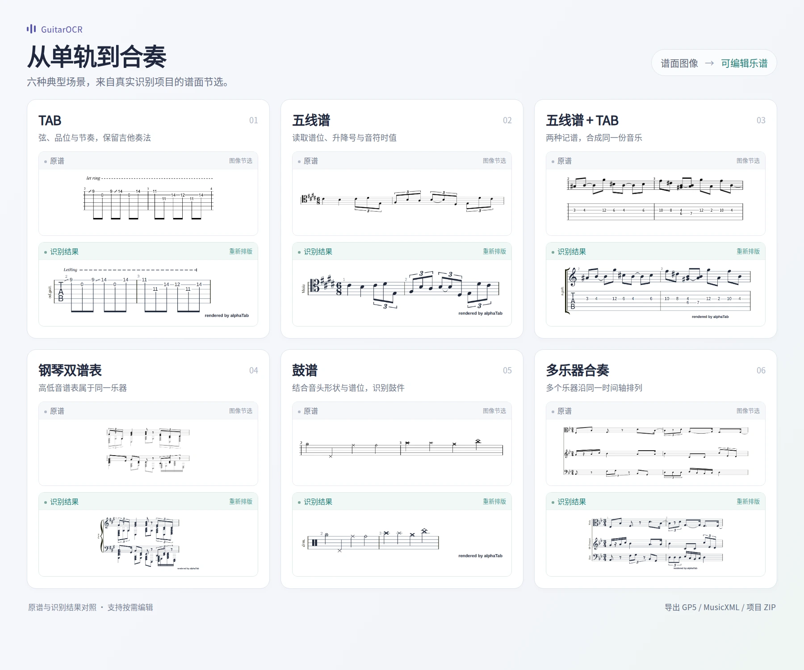
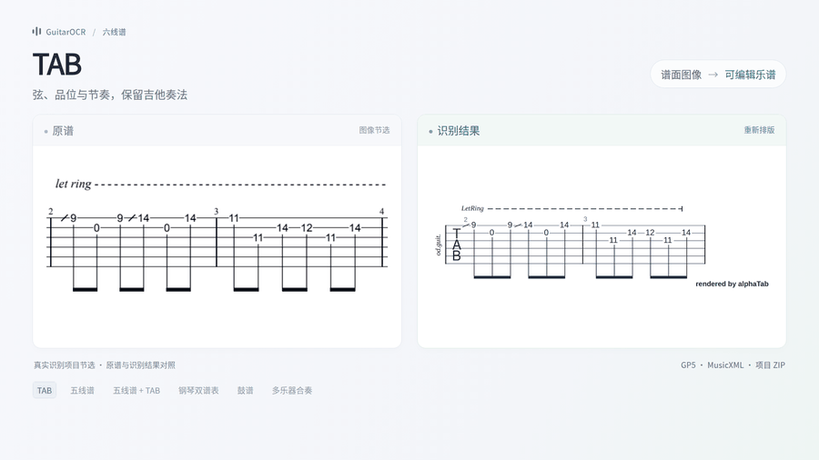
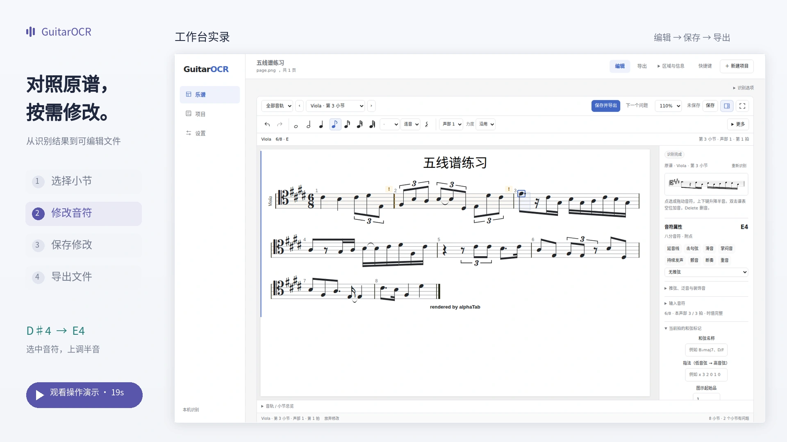
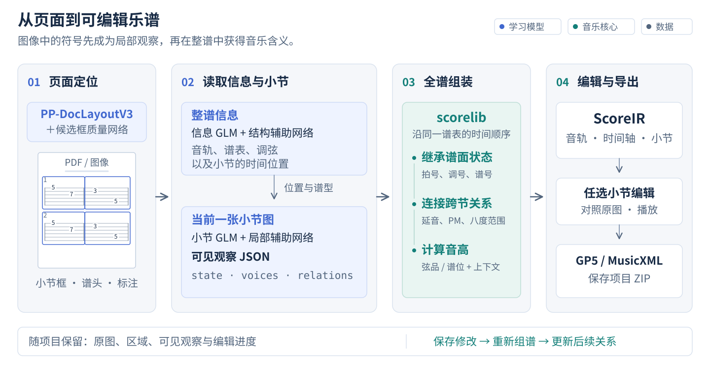
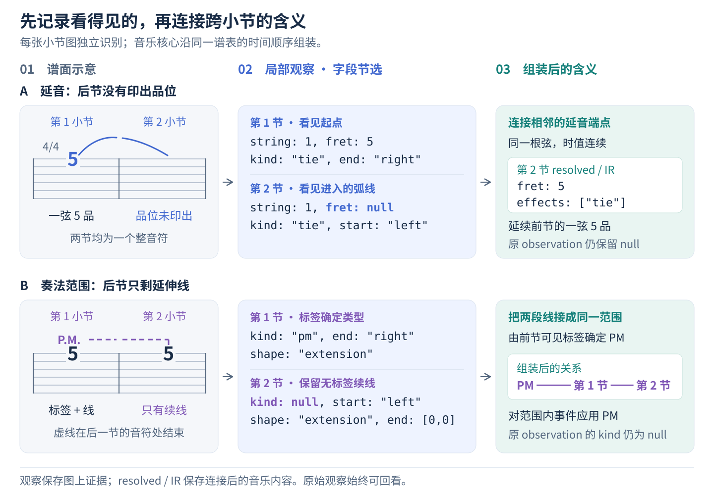
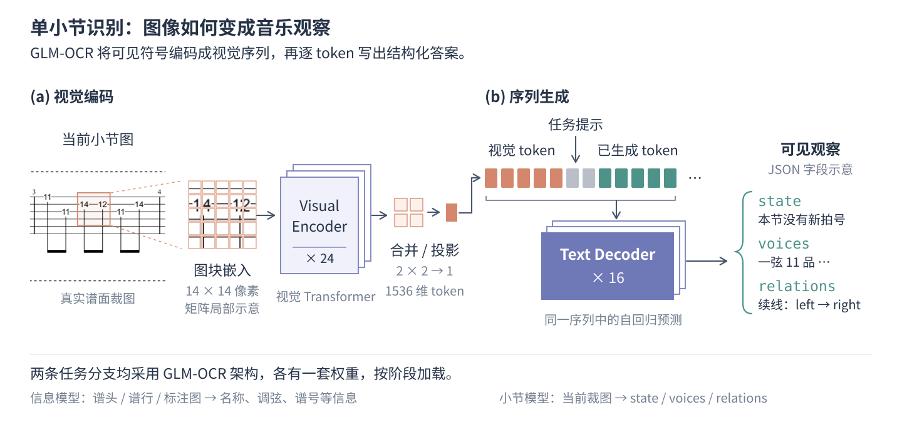
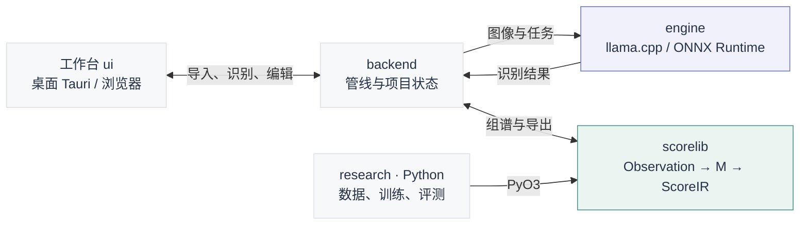

# GuitarOCR

把乐谱 **PDF 或图片变成可编辑的乐谱**，按需修改并导出 Guitar Pro（GP5）、MusicXML 或项目 ZIP。从 TAB、五线谱和五线谱＋TAB，到钢琴双谱表、鼓谱与多乐器合奏，使用同一套识别与编辑流程。

[下载 0.1](https://github.com/Flurry-L/guitarOCR/releases/tag/v0.1.0) · [演示](#演示) · [工作原理](#工作原理) · [识别网络](#识别网络) · [识别表现](#识别表现) · [代码导览](#代码导览) · [源码运行](#源码运行) · [数据与训练](#数据与训练)



以上为真实识别项目的节选；未印乐器名称的样例，已在软件中确认乐器信息。

## 演示

点击预览图查看视频。

| 六类乐谱识别 · 约 27 秒 | 修改音符与导出 · 约 19 秒 |
| --- | --- |
| <a href="docs/assets/score-types.mp4"></a> | <a href="docs/assets/editing.mp4"></a> |
| 从单轨到合奏，逐项展示原谱与重新排版的识别结果。 | 将第 3 小节首音 D♯4 改为 E4，保存并导出 GP5 / MusicXML。 |

## 开始使用

| 平台 | 安装与运行 |
| --- | --- |
| Windows x64 | 下载 `.exe` 安装包，需要 WebView2；支持 NVIDIA GPU 和 CPU |
| Apple 芯片 Mac | 下载 `.dmg`，要求 macOS 13.4+，使用 Apple GPU |
| Linux、Intel Mac | 从源码运行或构建 |
| 浏览器 | 连接自托管服务，识别在服务器完成 |

首次识别会下载约 3.4 GB 模型。也可以直接打开内置的 Harbor Light 示例，体验编辑和导出。

1. **导入** PDF 或图片，开始识别。
2. **检查区域**，调整或补上小节框，确认音轨、乐器和调弦。
3. **按需编辑**，点击任意小节，对照原图修改音符、节奏、奏法、和弦名与指法图。检测到具体问题的小节会单独提示；尚未组装完整的小节会预览已确定的事件，点击后可纠正对应的识别字段。
4. **直接导出** GP5 / MusicXML，或保存包含原图与编辑进度的项目 ZIP，无需逐节确认。

<details>
<summary>macOS 首次打开</summary>

当前安装包未签名、公证。如果提示无法打开，从本项目发布页下载并将应用拖到「应用程序」后执行：

```bash
xattr -dr com.apple.quarantine /Applications/GuitarOCR.app
```

</details>

## 工作原理

乐谱同时包含两种信息：**当前图上画了什么，以及这些符号在整首曲子里表示什么**。例如，TAB 中的 `5` 可以直接读出品位；下一节延续这个音时，谱面可能只画延音弧而省略数字。再如，PM 的标签只出现在范围开头，后面的虚线需要接回前面的标签。

GuitarOCR 因此把识别分成 **页面定位 → 局部观察 → 全谱组装**。网络从图片中读出符号、节奏和关系片段；组谱程序利用音轨、时间顺序和音乐语义，把这些观察变成可编辑、可导出的乐谱。



*图 1：以《春日影》的页面与裁图展示数据流，其余结构为机制示意。两条读取分支采用同一 GLM-OCR 架构，各有一套任务权重。橙色关联图像，靛蓝表示网络，青绿表示音乐核心与组装结果。*

### 页面定位：确定音乐在哪里、属于谁

PDF 先栅格化成页面图像。微调后的 **PP-DocLayoutV3** 在整页和局部视图上检测小节、谱头、谱号、速度及标注；候选框经质量网络评分，再合并重复区域。检测结果保留页面坐标，用于裁图和编辑器中的原图对照。

随后建立整谱结构：关系网络直接判断相邻谱行是否属于同一组同时演奏的谱行（system）、同一乐器；信息模型读取谱行中的乐器名、调弦等语义，接续网络判断换行或换页后的音轨归属。程序将横向对齐、同时演奏的小节放到统一的时间轴上。这里的 **音轨** 对应乐器部分，**谱表** 是音轨内部的书写层，**声部** 是小节内并行的节奏线；换到下一排谱不会自动产生新音轨。同一份音乐的五线谱与 TAB 可以合成一张局部图读取。

小节裁图保留本节的和弦名、指法图与奏法。小节模型把可见和弦名关联到音符事件，专门的指法图网络读取各弦品位、指法数字与横按；指法图作为和弦注释保存，谱首的指法库单独保留。

### 局部观察：把看见的内容表达清楚

小节模型每次读取 **当前一张小节图**，生成一个包含三部分的 JSON。程序将这份观察与已确定的音轨、谱表和小节位置一起保存，供下一阶段组装。

| 部分 | 模型记录的内容 | 例子 |
| --- | --- | --- |
| `state` | 当前印出的拍号、调号、谱号与谱号八度变化 | 看见 `4/4`；本节没有新拍号 |
| `voices` | 各声部的事件起点、时值、音符、休止与局部奏法 | TAB 的弦和品位；五线谱的谱位和临时升降号 |
| `relations` | 音符之间的连接、奏法范围，以及伸出裁图的端点 | 延音弧通向右侧；一条无标签虚线从左侧进入 |

五线谱与 TAB 同时出现时，每个事件分别保存 TAB 的 `notes` 与五线谱的 `notation_notes`。模型读取两组可见符号，组谱器获得定弦、谱号与移调信息后，才按音高匹配为一份音乐；和弦内的上下排列不必相同。鼓谱为每个音输出音头形状，例如普通音头、叉形、圆圈叉形，再与谱位一起解释鼓件；看不清的形状显式记为 `null`。

两组音符数量也可以不同：同音和弦可能共用一个五线谱音头，TAB 延音的数字可能完全省略。组谱器结合音高与延音关系恢复能够确定的指法，原始观察保留各自实际画出的符号。

这个表示保留了两种有用的区别。**没有印出的值**可以留空，例如延音后半段的 `fret: null`、无标签续线的 `kind: null`；**延伸到图外的关系**用 `left` / `right` 标记端点，供后续在相邻小节中匹配。

谱面状态还区分 `observed`（印出并读到）、`absent`（没有新标记）和 `unknown`（读不清）。组谱时，`absent` 可以沿连续小节继承前值，`unknown` 保留为待解决信息。这样，“这里没有再印拍号”和“这里的拍号没认清”会得到不同处理。完整字段和训练、推理共用的提示词见 [`observation.rs`](scorelib/src/observation.rs)。

### 全谱组装：让局部观察获得音乐含义

组谱器按同一音轨、谱表的小节顺序处理观察，依次完成以下工作：

1. **继承状态**：建立每节实际使用的拍号、调号、谱号等上下文。
2. **连接关系**：根据声部、事件端点、音符身份和可见线条位置，连接延音、击勾弦、滑音、PM、let ring 与八度范围。
3. **计算音高与双谱匹配**：TAB 使用弦、品位和调弦；五线谱使用谱位、谱号、调号和临时升降号，再处理移调与八度变化。双谱的两组音符在此匹配，局部图不需要提供不可见的定弦信息。
4. **生成乐谱表示**：输出每节的 M 文本，连同音轨、谱表、统一时间轴和注释组成整谱 ScoreIR。

双谱的两侧可以互相补足确定的信息。例如读到了弦、品位，且调弦、变调夹与移调关系已确定，就能计算对应音高。这个结果写入组装层，原始观察仍保留未读出的字段；两侧都读出但音高矛盾时，保留冲突供编辑。



*图 2：两类需要跨小节解释的情况。网络分别描述每张图，组谱器在连接成立后补足音乐含义；原始观察继续保留。图中的谱面为机制示意。*

以图中的延音为例，前节读到一弦 5 品，后节只读到同弦上的延音进入端和时值。连接成立后，后节的组装结果才得到 `fret: 5` 与延音标记。若把前节的品位编辑成 7，保存时重新组谱，后节的延音也会随之更新。

三个数据层各有用途：

| 表示 | 保存什么 | 用在哪里 |
| --- | --- | --- |
| **Observation JSON** | 当前图上的可见内容与开放端点 | 网络输出、组谱输入、回看识别依据 |
| **M 文本** | 已组装的小节音符、节奏和奏法 | 查看或编辑一个小节的音乐内容 |
| **ScoreIR** | `timeline` 与 `parts → staves → measures`，以及整谱注释 | 乐谱编辑与 GP5 / MusicXML 导出 |

上面延音例子的两节可写成：

```text
M time=4/4 | V0{@0:w:s1f5}
M | V0{@0:w:s1f5(tie)}
```

`V0` 是声部，`@0` 是小节内起点，`w` 是整音符，`s1f5` 是一弦 5 品。第二节继承 4/4，`tie` 表示延续前音。项目 ZIP 还保存原图、原始观察与编辑进度，便于继续编辑和回看识别依据。

识别后可以**直接导出 GP5，在 Guitar Pro 中继续编辑**。导出保留已确定的音符；双谱冲突处有完整 TAB 指法时采用 TAB，未知音不猜填，空缺用休止占位。音高和起点已知、时值未知时，临时延续到同声部的下一起点或小节末尾，并标注节奏待核对。同一声部时值重叠时，保留起点并缩短前音；超拍内容保留供修改。未确认的和弦名以文字保留，未连接的奏法不强行连到相邻音。处理位置在导出谱中标记，原始观察与项目内容保持不变。

## 识别网络

### GLM-OCR 如何把图片变成观察

信息读取与小节读取都基于 [GLM-OCR](https://github.com/zai-org/GLM-OCR) 微调，采用 **同一网络架构、两套任务权重**。两者都是 **视觉编码器 → 多模态投影 → 自回归文本解码器**：视觉部分把图中的位置、符号和线条编码成特征；文本部分在这些特征与任务提示的条件下，逐个生成组成 JSON 的 token。



*图 3：一次小节读取的内部结构。图像转换成视觉 token 后，与任务提示一起供文本模型生成答案。下方的信息任务使用同架构的另一套权重。*

当前模型的具体结构如下，配置见 [`config.json`](weights/score_ocr/merged/config.json)：

| 环节 | 做什么 | 当前结构 |
| --- | --- | --- |
| 图像预处理 | 保持乐谱比例，控制输入面积，补白后划成图块 | 动态分辨率，14 × 14 图块 |
| 视觉编码器 | 让每个图块结合周围内容，表示数字、谱线、符干与连线的关系 | 24 层视觉 Transformer，特征维度 1024 |
| 多模态投影 | 压缩视觉序列，并转换到文本模型的特征空间 | 2 × 2 空间下采样，投影到 1536 维 |
| 文本解码器 | 结合图像、任务提示和已生成内容，预测下一个 token | 16 层 Decoder，特征维度 1536 |

两套权重分别保存在 `weights/information/` 与 `weights/score_ocr/`：**信息分支**读取标题、乐器名、调弦、谱号和标注等字段；**小节分支**读取音符、节奏与关系，输出前述观察 JSON。产品按阶段切换各自的视觉与文本权重。

### 结构改动与微调范围

| 模型 | 相对原模型的改动 | 实际更新的参数 |
| --- | --- | --- |
| **PP-DocLayoutV3** | 沿用 HGNetV2 骨干、特征融合与 Transformer 检测结构，输出类别调整为 **11 类乐谱区域** | 直接微调骨干后续阶段、特征融合和检测模块；沿用上游设置，冻结输入卷积模块（stem）与骨干 BatchNorm，其余骨干参数使用主学习率的 **0.05 倍** |
| **GLM-OCR 小节模型** | 保留原有视觉塔、投影和文本解码器的层数与连接方式；**扩充音乐词表**，词嵌入与输出层随之扩展 | 在视觉塔、投影和文本解码器的线性层训练 **LoRA（rank 64，alpha 128）**；同时直接更新 `embed_tokens`、`lm_head`，包括已有 token 的权重；其余底座参数冻结 |

LoRA 学习的是附加在原权重上的低秩增量，小节模型部署前将增量合并回权重。信息模型还带有一个 **仅作用于文本解码器的 LoRA（rank 16，alpha 32）**，用于谱表与谱号读取，按任务启用。对应配置见 [版面训练](research/configs/layout/train.yaml)、[小节训练](research/configs/measures/train.yaml)与[信息 adapter](weights/information/merged/information_adapter/adapter_config.json)。

### 辅助网络分别解决什么问题

页面结构、拍调号和指法图有各自明确的输入与输出，使用独立的小网络读取。它们在对应阶段提供结构或局部信息，再与 GLM 的输出一起组装。

| 任务 | 输入 → 输出 | 网络形式 |
| --- | --- | --- |
| 区域定位与质量 | 页面 → 小节 / 信息框；候选图像与几何 → 框质量 | PP-DocLayoutV3；MobileNetV3 质量网络 |
| 谱行与音轨结构 | 谱行图、相邻候选与几何 → 同系统、同乐器、跨行接续 | 卷积图像编码器 + 几何特征分类器 |
| 音乐状态 | 小节 → 印出的拍号、调号；谱号及周围谱线、目标框 → 谱号；谱行 → 谱型、弦数 | MobileNetV3 + 空间注意力、小型 CNN |
| 文字定位与归属 | 图像 → 文字区域；名称或文字位置 → 乐器类别、和弦名归属 | PP-OCRv5 文字检测、多尺度 CNN、文本 CNN |
| 指法图 | 图形裁图 → 起始品位、各弦品位、指法数字、横按 | ResNet18 图像编码器 + 多个输出头 |

这些模型输出的字段可对应到具体图像区域。例如，拍号网络回答“这张图是否印了新拍号、是多少”，继承到后续小节由组谱器完成。模型定义集中在 [`research/models/`](research/models)，应用中的读取与融合在 [`backend/src/recognition/`](backend/src/recognition)。

## 识别表现

当前小节模型在本轮测试集的全部 **127 组曲目／乐句、3,802 张裁图**上评测。数据来自 GP 源谱与合成谱，经 Guitar Pro、alphaTab、Verovio 渲染，覆盖 TAB、五线谱、双谱和鼓谱。同一曲目或乐句的外观变体放在同一数据划分中；推理每次只输入一张小节图，使用合并权重与 vLLM。

TAB 样例包含和弦图、PM / let ring、击勾弦与滑音；五线谱样例包含不同谱号、临时升降号、附点与三连音；双谱样例覆盖独立排列、共用音头和省略 TAB 数字的延音；鼓谱样例覆盖不同谱位、音头形状与鼓件组合。

| 谱型 | 渲染器 | 裁图数 | 可见音符 F1 | 节奏 F1 | 局部连线关系 F1 |
| --- | --- | ---: | ---: | ---: | ---: |
| TAB | Guitar Pro | 528 | 99.51% | 99.74% | 93.52% |
| TAB | alphaTab | 960 | 98.18% | 97.25% | 59.19% |
| 五线谱 | Guitar Pro | 184 | 99.55% | 100.00% | 81.16% |
| 五线谱 | alphaTab | 312 | 99.45% | 99.84% | 76.62% |
| 五线谱 | Verovio | 516 | 99.35% | 99.81% | 84.77% |
| 双谱 | Guitar Pro | 158 | 99.65% | 99.69% | 58.30% |
| 双谱 | alphaTab | 632 | 97.47% | 99.86% | 53.05% |
| 鼓谱 | alphaTab | 512 | 96.70% | 99.75% | — |
| **合计** | | **3,802** | **98.45%** | **99.38%** | **72.95%** |

F1 同时考虑漏读和误读。音符项比较可见内容与起点，双谱中的 TAB 和五线符号分别计数；节奏项比较事件起点与时值，时间容差为 **1/8 个四分音符**。连线关系还要求类型与端点对应，`—` 表示没有对应标签。评测实现见 [`measures.py`](research/evaluation/measures.py)。

**音符与节奏读得较稳，连线的类型和端点仍是主要短板**，尤其是双谱延音、PM 范围与换把滑音。和弦名及其起点的总体 F1 为 **92.44%**，仍有漏读。

另用**标注好的拍号、谱号、调号、调弦等状态与声部对应**辅助跨节组装，音符内容连同时值的 F1 为 **97.78%**，PM / let ring 等范围记号所作用事件的 F1 为 **92.94%**。这项实验衡量给定正确辅助信息时的组谱效果，与产品从整页定位、读取信息到导出的全流程准确率不同。

整页定位另用 **17 组曲目／乐句的 328 页**测试，包含 alphaTab 256 页、Guitar Pro 72 页，覆盖 TAB、五线谱与双谱。11 类区域检测的 COCO AP 为 **0.938**；经过候选质量筛选与融合后，**3,008 个参考小节全部匹配，另多出 1 个框**（IoU ≥ 0.5）。

**原生产品多谱型检查**。六份样例中，吉他双谱 **31/32**、纯五线谱 **30/32**、鼓谱 **4/5**、钢琴双谱表 **16/16**、三乐器合奏 **24/24**、C4 谱号 **8/8** 小节能完整组装；音轨、谱表和换行接续均保持正确。钢琴、合奏与 C4 样例未印乐器名称，测试先通过软件确认源谱的乐器与移调，再识别小节。

**真实 PDF 实例：《春日影-五线谱tab.pdf》**。原生产品从六页 PDF 自动得到 **一个吉他音轨、141 个双谱小节**；141 份观察均能解析，整曲拍号为 6/8、调号为 0。其中 **111 节能完整组装，30 节仍有音符配对等未决项**。整曲可直接导出 GP5：这 30 节的 **271 个已知 TAB 音符与起点全部保留**，5 处重叠时值缩短，1 处无音高事件以休止占位。抽查仍有谱位差一级、漏读临时升号、TAB 数字误读等错误；导出成功与逐音正确是两项不同指标。

**《击弦练习曲》（`jixian.pdf`）**包含双谱、密集 H 击弦与拨弦方向记号。产品得到 **1 轨、17 节、128 个音符**，GP5 经独立读取确认；第 7 节仍漏读一个音。两节双谱音高冲突采用可用 TAB 指法，局部未确认的标注不阻断下载。此类真实 PDF 用于检查完整流程和失败位置，未作为训练样本。

## 代码导览

桌面应用和网页服务使用同一套工作台、Rust 后端与音乐核心。桌面由 Tauri 启动本机后端，网页连接服务器后端。Python 负责数据生产、训练和评估，并通过 PyO3 调用同一个 `scorelib`，让研究与产品使用一致的组谱规则。



| 模块 | 职责 | 建议阅读入口 |
| --- | --- | --- |
| `ui/` | 原图、区域与乐谱编辑，项目管理 | [`workbench/app.js`](ui/workbench/app.js) |
| `desktop/` | Tauri 窗口、本机后端与系统交互 | [`main.rs`](desktop/src-tauri/src/main.rs) |
| `backend/` | 导入、识别管线、项目状态和编辑接口 | [`pipeline.rs`](backend/src/pipeline.rs) → [`recognition.rs`](backend/src/recognition.rs) |
| `engine/` | 设备选择、llama.cpp 模型进程与推理调度 | [`runtime.rs`](engine/src/runtime.rs) |
| `scorelib/` | 观察组装、音乐表示、GP5 / MusicXML 导出 | [`observation.rs`](scorelib/src/observation.rs) → [`score.rs`](scorelib/src/score.rs) → [`music_exports.rs`](scorelib/src/music_exports.rs) |
| `research/` | 数据生成、网络定义、训练、评测与模型导出 | [`data/observations.py`](research/data/observations.py)、[`models/`](research/models)、[`training/`](research/training) |
| `gpbridge/` | 调用 Guitar Pro 导出 PDF、源谱结构与绘制坐标，用于造数据 | [`guitarpro_pdf.py`](gpbridge/guitarpro_pdf.py) |
| `weights/` | 当前模型、训练权重与部署清单 | [`distribution.json`](weights/distribution.json) |
| `scripts/`、`deploy/` | 原生组件收集、安装包构建与服务配置 | [`desktop.yml`](.github/workflows/desktop.yml)、[`guitarocr.service`](deploy/guitarocr.service) |

第一次读代码，建议沿 **`pipeline.rs` → `recognition.rs` → `observation.rs` → `score.rs`** 走一遍：先看阶段怎样调度，再看图像怎样读成观察，最后看观察怎样组成小节与整谱。

### 小节怎样并行识别

当前小节的观察不依赖前一节的识别结果，因此可以同时送入模型。后端按需读取裁图，所有项目共用一个有并发上限的 FIFO 请求队列；一个请求完成就立即补入下一节。底层 llama.cpp 使用连续批处理，让正在生成的请求共享解码计算。这个组织方式与 [MinerU 的区域识别](https://github.com/opendatalab/mineru-vl-utils/blob/main/mineru_vl_utils/mineru_client.py)相似：独立区域并行读取，再按照原始位置恢复文档结构。

每节完成后立即保存观察并更新进度，最终按音轨与小节顺序统一组谱。取消只撤销当前项目的请求，已完成小节可以续用，其他项目继续运行。信息模型与小节模型按阶段排队切换，同一套权重可以同时服务多个项目。桌面默认同时处理 **2 个请求**，服务器默认 **4 个**；`--slots 1..4` 可以按设备内存调整。并行度增加会占用更多上下文缓存，实际加速还取决于图像编码和输出长度。

在 H100 上用《春日影》的 8 个 TAB 小节测试原生产品管线：版面与信息已准备、模型预热后，从 1 路增至 4 路，小节识别与组谱耗时由 **4.02 秒降至 2.02 秒**，其中模型阶段由 **3.70 秒降至 1.65 秒**。两种并行度输出的可见观察与最终乐谱一致。

## 源码运行

需要 Rust 1.90+。先启动工作台，打开内置示例即可体验编辑和导出：

```bash
GIT_LFS_SKIP_SMUDGE=1 git clone https://github.com/Flurry-L/guitarOCR.git
cd guitarOCR
cargo run --locked -p guitarocr-backend -- --assets ui/workbench --port 7860
```

访问 `http://127.0.0.1:7860`。启用识别时，按下方构建说明准备 ONNX Runtime、PDFium 和 llama.cpp，再通过 `--resources` 指定原生组件目录，`--models` 指定模型缓存目录：

```bash
cargo run --locked -p guitarocr-backend -- \
  --assets ui/workbench --resources desktop/src-tauri/resources/native \
  --models tools/model-cache --port 7860
```

### 服务部署

将准备好的 `desktop/src-tauri/resources/` 放到服务目录。创建管理员后，以服务模式启动，前方配置 HTTPS 反向代理：

```bash
read -rsp '管理员密码: ' GUITAROCR_ADMIN_PASSWORD
export GUITAROCR_ADMIN_PASSWORD
./native/guitarocr-backend --projects /var/lib/guitarocr/projects --create-admin admin
unset GUITAROCR_ADMIN_PASSWORD
./native/guitarocr-backend --server --bind 127.0.0.1 --port 8080 \
  --public-url https://ocr.example.com --assets ui/workbench --resources native \
  --projects /var/lib/guitarocr/projects --models /var/lib/guitarocr/models --slots 4
```

服务配置见 [`deploy/guitarocr.service`](deploy/guitarocr.service) 和 [`deploy/Caddyfile`](deploy/Caddyfile)。项目、账号与导出保存在 `--projects` 指定的目录，`--slots` 控制推理并发。

## 数据与训练

### 模型学到的答案从哪里来

训练数据来自 **GP 源谱与程序合成谱**，通过 Guitar Pro、alphaTab、Verovio 获得不同排版风格。`gpbridge` 导出 Guitar Pro 的 PDF、绘制坐标和源谱结构；合成谱补充延音、跨节奏法、八度线、和弦图等组合。

源谱给出完整音乐含义，渲染结果决定当前图上实际可见的内容。数据管线将二者按事件与绘制坐标对齐，得到 **一张小节裁图 + 任务提示 → 该图的观察 JSON**。例如，延音后节省略了数字，但仍有可定位到弦的延音标记时，可以记录 `fret: null` 和进入的延音弧；若 TAB 一侧完全没有画出这个音，就不添加音符占位，由五线谱上的可见延音关系参与后续组装。无标签的 PM 续线保留 `kind: null`。这种监督让模型学习局部可见性，跨节信息由同一个组谱器恢复。

训练时，在答案 token 上计算自回归预测损失。当前使用 LoRA 微调视觉塔、投影和文本模型中的目标线性层，词嵌入与输出层另外参与训练。不同渲染风格与扫描增强用于学习符号共同的形状和空间关系；同曲的字体、排版变体放在同一数据划分中。

评估分为两层：裁图评估检查音符、节奏、奏法和关系是否读对；整谱评估将观察组装后与完整乐谱比较，检查状态继承、跨节连接和最终音高。产品使用的 GGUF 与 ONNX 模型由这些训练结果导出。

### 准备训练环境

环境使用 Python 3.11、`uv` 和 Rust，权重通过 Git LFS 获取：

```bash
git lfs pull --include='weights/**'
uv sync --locked --package guitarocr-research --python 3.11 --extra glm-ocr --extra training --extra dev
uv run --no-sync python -m playwright install chromium
source .venv/bin/activate
```

OCR 微调另需在该环境安装 [LLaMA-Factory](https://github.com/hiyouga/LLaMA-Factory) 和与 PyTorch / CUDA 对应的 FlashAttention 2。

### 小节模型

先生成数据，再运行 [`research/configs/measures/train.yaml`](research/configs/measures/train.yaml)。配置从当前小节模型继续微调，产物写入 `output/observation_ocr`。

```bash
for mode in tab notation tab-chords both standard drums; do
  python -m research.data.observations --mode "$mode" --output "database/observations-$mode"
done
python -m research.data.observations \
  --merge database/observations-tab database/observations-notation database/observations-tab-chords \
    database/observations-both database/observations-standard database/observations-drums \
  --output database/observations
python -m research.training.measures --tokenize-only
python -m research.training.measures --check
CUDA_VISIBLE_DEVICES=0 python -m research.training.measures
```

合并权重、评测和部署转换分别使用：

```bash
python -m research.export.export_glm --base weights/score_ocr/merged \
  --adapter output/observation_ocr --output output/observation_ocr/merged
python -m research.evaluation.measures --manifest database/observations/manifest_test.jsonl \
  --model output/observation_ocr/merged --output output/observation-test
python -m research.export.export_gguf --llama-cpp /path/to/llama.cpp \
  --model output/observation_ocr/merged --output output/gguf/score_ocr
```

裁图评测使用独立的 [vLLM 环境](research/configs/runtime-vllm.txt)，默认位置为 `tools/vllm-venv`，可通过 `GUITAROCR_VLLM_PYTHON` 指定 Python。报告同时查看音符、节奏、奏法、关系和最终组谱结果；整谱评测入口是 [`research.evaluation.pipeline`](research/evaluation/pipeline.py)，调用实际后端完成识别。

### 其他训练与数据入口

| 任务 | 入口 |
| --- | --- |
| GP 源谱渲染与标签生成 | `research.data.run`、`research.data.build_measure_data`；GP8 原生桥见 [`gpbridge/native/`](gpbridge/native) |
| 信息读取数据 | `research.data.build_info_data`；训练使用 `research.training.measures --config ...` |
| 版面检测与候选质量 | `research.training.layout`、`layout_quality` |
| 拍号、调号、谱号与谱表 | `research.training.state`、`calibrate_state`、`clef_spatial`、`staff_evidence` |
| 谱行、名称与音轨关系 | `research.training.structure_relation`、`part_continuation`、`staff_label`、`instrument_text` |
| 和弦名与指法图 | `research.training.chord_text_roles`、`chord_evidence`、`chord_calibration` |
| 辅助模型部署导出 | `research.export.export_auxiliary`，其他任务在各训练入口中导出 |

各入口的 `--help` 给出数据与参数。Guitar Pro 数据生产使用 GP 8.1.2.37，Linux 通过 Wine 运行；具体运行目录由 `research.data.run` 的参数指定。当前采用的模型保存在 `weights/`，数据集、候选模型和中间产物分别放在 `database/`、`output/`、`tools/`。

## 构建应用

桌面构建需要 Node.js 22、Rust 1.90+、CMake、系统 C/C++ 工具链及 [Tauri 系统依赖](https://v2.tauri.app/start/prerequisites/)。安装包包含后端、工作台和推理组件，模型在首次识别时下载。

[桌面构建工作流](.github/workflows/desktop.yml) 提供 Windows x64 和 Apple 芯片 Mac 的完整构建步骤，可在 GitHub Actions 中选择平台运行。原生组件准备分成三步：

1. [`build_llamacpp_runtime.py`](scripts/build_llamacpp_runtime.py) 构建 CPU、CUDA 或 Metal 推理组件，也可复用 [`llamacpp-runtime.json`](scripts/llamacpp-runtime.json) 中的发布资源。
2. [`collect_native_assets.py`](scripts/collect_native_assets.py) 收集 llama.cpp、ONNX Runtime 和 PDFium，生成组件清单。
3. [`prepare_native_desktop.mjs`](scripts/prepare_native_desktop.mjs) 将后端、UI 与原生组件整理到桌面资源目录。

组件清单准备好后，在仓库根目录执行：

```bash
npm ci --prefix desktop
npm run native:build --prefix desktop
node scripts/prepare_native_desktop.mjs --manifest /path/to/manifest.json --require-inference
npm run build --prefix desktop
```

安装包输出到 `target/release/bundle/`。服务部署使用 `desktop/src-tauri/resources/` 中的后端和资源即可。
