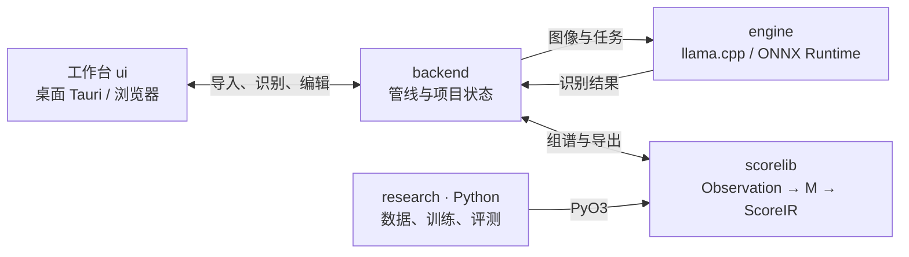

# GuitarOCR

把乐谱 **PDF 或图片变成可编辑的乐谱**，按需试听、修改并导出 Guitar Pro（GP5）、MusicXML 或项目 ZIP。从吉他/贝斯 TAB、五线谱和五线谱＋TAB 双谱，到钢琴双谱表、鼓谱与多乐器合奏，使用同一套识别与编辑工作台。

[下载 0.3.0](https://github.com/Flurry-L/guitarOCR/releases/tag/v0.3.0) · [快速上手](#开始使用) · [工作原理](#工作原理) · [架构与代码导览](#架构与代码导览) · [算法与评测详情](docs/algorithm-and-models.md) · [IR 与 M 语言规范](docs/ir-and-m-spec.md) · [开发与训练指南](docs/development.md)


## 演示

点击预览图查看视频。

| 六类乐谱识别 · 约 27 秒 | 修改音符与导出 · 约 19 秒 |
| --- | --- |
| <a href="docs/assets/score-types.mp4"></a> | <a href="docs/assets/editing.mp4"></a> |
| 从单轨到合奏，逐项展示原谱与重新排版的识别结果。 | 将第 3 小节首音 D♯4 改为 E4，保存并导出 GP5 / MusicXML。 |

## 开始使用

| 平台 | 安装与运行 |
| --- | --- |
| Windows x64 | 下载 `.exe` 安装包，需要 WebView2；支持 NVIDIA GPU 和 CPU |
| Apple 芯片 Mac | 下载 `.dmg`，要求 macOS 13.4+，使用 Apple GPU |
| Linux、Intel Mac | 从源码运行或构建（见 [开发与构建指南](docs/development.md)） |
| 浏览器 | 连接自托管服务，识别在服务器完成 |

首次识别会下载约 3.4 GB 模型；也可以直接打开内置的 **Harbor Light** 示例，体验编辑、单节试听和导出。

1. **导入** PDF 或图片，开始识别。
2. **检查区域与定弦**，调整或补上小节框，确认音轨、乐器和定弦（支持选择预设或直接输入 `E4, B3, G3, D3, A2, E2` 音名）。
3. **对照原图编辑与试听**，选中小节后点击「试听本节」，或在乐谱区域按空格播放／停止。结合右侧裁图修改音符、节奏、奏法、和弦名与指法图。需要补全的小节会单独提示。
4. **导出或继续编辑**，导出 GP5 / MusicXML，或保存包含原图与编辑进度的项目 ZIP。

试听按音轨的乐器音色播放当前小节，音色随应用内置，无需联网。谱面与试听共用 alphaTab，处理变速、力度、变调夹、延音弧、推弦、滑音、泛音与装饰音。图形编辑可直接试听草稿；M 文本修改会在试听前保存。

<details>
<summary>macOS 首次打开提示</summary>

当前安装包未签名、公证。如果提示无法打开，从本项目发布页下载并将应用拖到「应用程序」后执行：

```bash
xattr -dr com.apple.quarantine /Applications/GuitarOCR.app
```

</details>

## 工作原理

GuitarOCR 按 **页面定位 → 局部观察 → 全谱组装** 处理乐谱：

1. **页面定位（PP-DocLayoutV3 + 谱行关系网络）**：检测小节、谱头、谱号、速度与和弦框，恢复多轨系统（System）与跨行音轨归属。
2. **局部观察（微调 GLM-OCR + 辅助 ONNX 网络）**：逐张读取小节裁图，按 JSON Schema 输出音符、时值、谱面状态及延伸到裁图外的连线。
3. **全谱组装（Rust `scorelib`）**：按音轨与时间轴顺序继承拍调号状态、连接跨节延音/滑音/PM 虚线、对齐五线谱与 TAB 双谱音高，生成可编辑的 `M` 文本与 `ScoreIR`。


在 **3,789 张独立小节裁图** 基准上，小节模型的 **可见音符 F1 为 97.87%**、**节奏 F1 为 99.08%**、**局部连线关系 F1 为 70.77%**；328 页版面检测的小节框召回率为 **3,008 / 3,008**。完整算法细节、模型微调结构与各谱型评测表见 **[算法设计与识别表现](docs/algorithm-and-models.md)**。

## 架构与代码导览

桌面应用（Tauri）和网页服务共享同一套原生 ES Module 工作台、Rust 后端与音乐核心 `scorelib`；Python 研究端通过 PyO3 绑定调用同一个 `scorelib`。



| 模块 | 职责 | 建议阅读入口 |
| --- | --- | --- |
| `ui/` | 原图对照、版面框微调、可视化/文本乐谱编辑与 WebAudio 试听 | [`workbench/app.js`](ui/workbench/app.js)、[`measure-editor.js`](ui/workbench/measure-editor.js)、[`audio-preview.js`](ui/workbench/audio-preview.js) |
| `desktop/` | Tauri 桌面窗口、本机后端托管与系统交互 | [`main.rs`](desktop/src-tauri/src/main.rs) |
| `backend/` | 导入、OCR 阶段管线、图像策略与项目会话管理 | [`pipeline.rs`](backend/src/pipeline.rs) → [`recognition.rs`](backend/src/recognition.rs)（图像策略见 [`image_policy.rs`](backend/src/recognition/image_policy.rs)） |
| `engine/` | 硬件加速探测、`llama.cpp` 连续批处理进程与 ONNX 推理调度 | [`runtime.rs`](engine/src/runtime.rs) |
| `scorelib/` | 观察类型、信息提示词与解析、音高转换、跨节组装及导出 | [`information.rs`](scorelib/src/information.rs)、[`observation.rs`](scorelib/src/observation.rs)、[`score.rs`](scorelib/src/score.rs)、[`pitch.rs`](scorelib/src/pitch.rs) → [`music_exports.rs`](scorelib/src/music_exports.rs) |
| `research/` | 合成与 GP 源谱数据生成、模型定义、训练、评测与 GGUF/ONNX 导出 | [`data/observations.py`](research/data/observations.py)、[`models/`](research/models)、[`training/`](research/training) |
| `gpbridge/` | 调用 Guitar Pro 导出 PDF、源谱结构与绘制坐标 | [`guitarpro_pdf.py`](gpbridge/guitarpro_pdf.py) |

## 快速启动与深入阅读

使用源码快速启动工作台（仅需 Rust 1.90+）：

```bash
GIT_LFS_SKIP_SMUDGE=1 git clone https://github.com/Flurry-L/guitarOCR.git
cd guitarOCR
cargo run --locked -p guitarocr-backend -- --assets ui/workbench --port 7860
```

更多专题文档：

- **[算法设计与识别表现（`docs/algorithm-and-models.md`）](docs/algorithm-and-models.md)**：三阶段识别流程、GLM-OCR / PP-DocLayoutV3 / ONNX 辅助网络详情与完整评测数据。
- **[中间表示与 M 语言规范（`docs/ir-and-m-spec.md`）](docs/ir-and-m-spec.md)**：`Observation JSON` 字段说明、`M` 语言语法速查表与 `ScoreIR` 结构规范。
- **[开发、构建与训练指南（`docs/development.md`）](docs/development.md)**：桌面端打包、服务端部署、数据集构建与 LoRA 微调命令。
